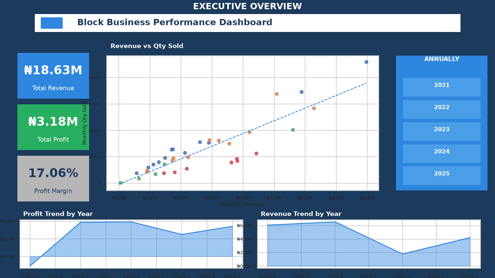
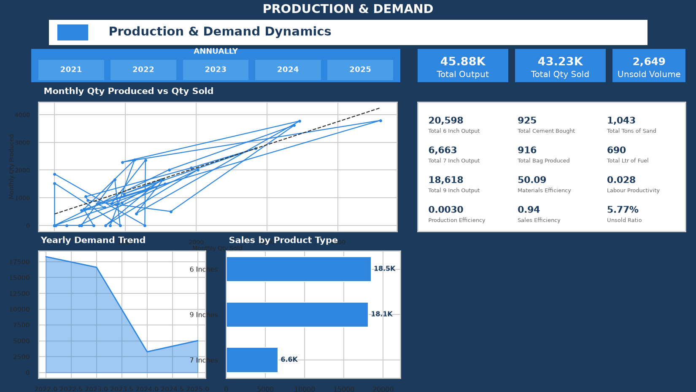
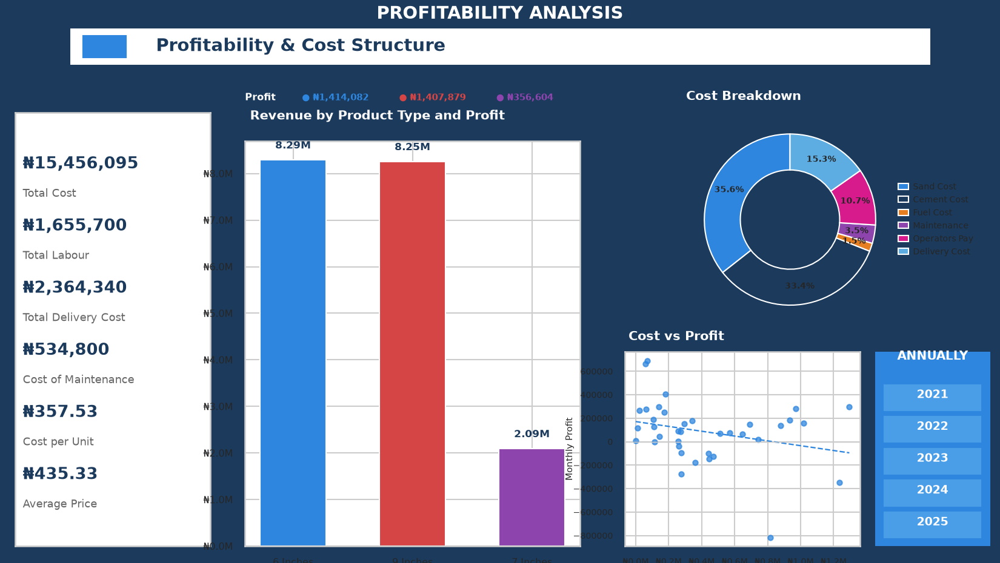
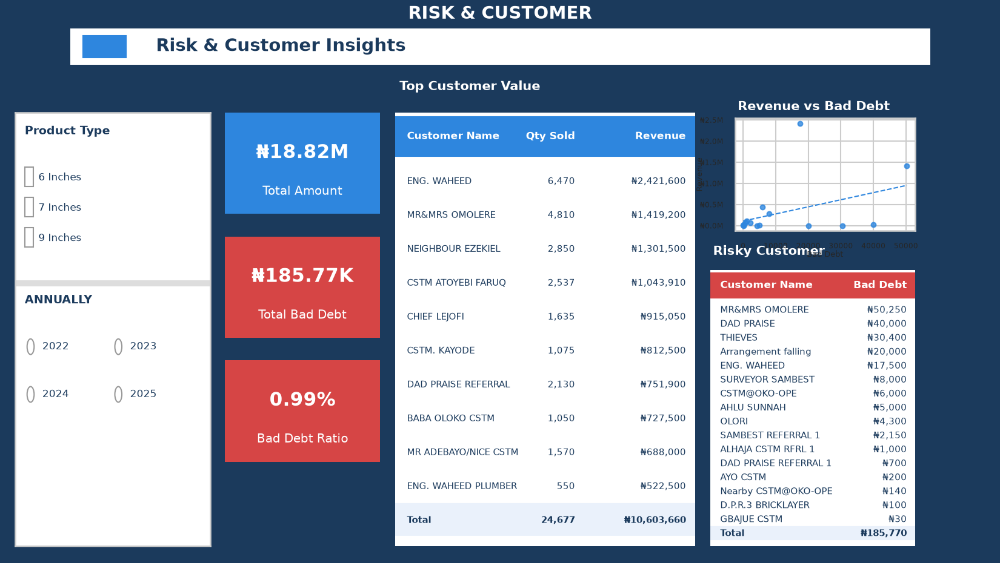

# 🧱 Block Production & Sales Performance Analysis

📊 **A Python-based business analytics project | December 2021 – December 2025**

This project examines production, sales, profitability, customer behaviour, and credit risk for a block-moulding business. The analysis was first developed through Excel dashboards and supporting SPSS/STATA statistical work, then rebuilt, cross-checked, and extended in Python.

> **Business question:** What actually drives profit—and what should the business monitor to make better production, pricing, cost-control, and customer decisions?

## 🎯 Project at a Glance

* **Business:** Concrete block production and sales (6-inch, 7-inch, and 9-inch blocks)
* **Period covered:** December 2021 to December 2025
* **Analytical workflow:** Data preparation → exploratory analysis → KPI and trend analysis → statistical modelling → validation → business recommendations
* **Tools:** Python, pandas, NumPy, Matplotlib, Seaborn, SciPy, statsmodels, Excel, SPSS/STATA, and Power BI

## 💡 Executive Highlights

* 💰 **₦3,178,565 total profit** from **₦18,633,540 revenue**, representing a **17.1% profit margin**.
* 🧱 **45,879 blocks produced** and **43,230 blocks sold**—a reported **94.2% sell-through**.
* 📈 Production was strongly associated with sales, cost, and revenue (**r ≈ 0.82–0.85**), but its relationship with profit was very weak (**r = 0.09**, not statistically significant). **Higher output alone did not guarantee higher profit.**
* 🧮 The profit-driver model identified sales volume and cost as important factors. The reported estimates were approximately **₦221 additional monthly profit per additional block sold** and **₦0.63 lower profit per additional ₦1 of cost**. Both were statistically significant (**p < 0.001**); model **R² = 0.49**. A robustness check confirmed the findings were not driven solely by product mix.
* 🗓️ Revenue did not show a statistically significant time trend (**p = 0.33**). Production declined by approximately **31 blocks per month** (**p = 0.004**) during a period of reported operational disruption; sales were supported by existing stock.
* 🤝 **40% of customers were repeat buyers**, accounting for **82% of revenue**—a concentrated and valuable customer relationship base.
* 🧾 The reported cost mix was **70.5% variable** and **29.5% fixed**. Sand and cement represented roughly two-thirds of total cost. Cost per block increased from **₦148.8 in 2021** to **₦546.7 in 2025**.
* 🛡️ Bad debt represented **0.99% of billed amount overall**. Its relationship with revenue was weak (**r = 0.37**) and not statistically significant in the reported analysis.

## 🧪 Analytical Approach

1. **Data preparation and quality checks** — standardized field names, reviewed dates and derived calendar fields from the date column, and documented source-data issues.
2. **Exploratory and descriptive analysis** — production and sales patterns, product performance, cost composition, customer behaviour, and business KPIs.
3. **Statistical analysis** — correlation analysis and OLS regression to examine profit drivers, revenue drivers, and time trends; included a product-mix robustness check.
4. **Cross-tool validation** — compared Python results with the earlier Excel and SPSS/STATA work, documenting matches and discrepancies.
5. **Business-focused extensions** — quarterly summaries, exported analytical tables, and product-filtered sales breakdowns.

### ⚠️ Data Handling Notes

* Blank production values were treated as missing where appropriate—not automatically replaced with zero. Any calculation-specific treatment is documented in the notebook.
* Two sales dates recorded as 2014 were corrected to 2024 after review.
* The earlier customer-value pivot excluded two customers whose sales were fully recorded as bad debt, understating quantity sold by 63 blocks.
* One month's blank total cost was derived from its single recorded cost component.
* These are observational business-record analyses. Regression estimates describe associations in the available records; they should not be interpreted as proof of causation.

## ✅ Validation Against Earlier Analysis

The Python workflow was cross-checked against the original report. **Nine of 11 checked figures matched exactly**, including the reported correlation coefficients, cost-per-block progression, the 51% price increase from 2023 to 2024, and both regression R² values. The notebook documents the comparison and two small narrative corrections.

## 📂 Repository Structure

```text
Block-Production-Sales-Python-Analysis/
├── Block_Production_Analysis.ipynb        # Python analysis notebook
├── README.md                              # Project overview and findings
├── requirements.txt                       # Python dependencies
└── data/
    ├── Block_Production_Sales_Source.xlsx # Original business workbook
    └── README.md                          # Source-data notes
```

├── Block_Production_Analysis.ipynb        # Full analysis: cleaning, 17 sections, extensions, validation
├── Block_Production___Sales_Performance_Analysis.xlsx   # Source data
├── page1_executive_overview.png           # Dashboard page 1
├── page2_profitability_analysis.png       # Dashboard page 2
├── page3_production_demand.png            # Dashboard page 3
├── page4_risk_customer.png                # Dashboard page 4
└── README.md


## 📌 Main Deliverables

* 📓 Python notebook covering data preparation, analysis, validation, and extensions
* 📊 Reproduction of the original dashboard's analytical themes: Executive Overview, Profitability, Production & Demand, and Risk & Customer
* 📄 Executive summary report (available as a separate PDF)
* 🗃️ Original source workbook, included for transparency and reproducibility

## 🔍 What This Analysis Suggests the Business Should Monitor

* **Profit per block and cost per block**—not production volume alone
* **Sales volume and realized selling price** alongside production output
* **Sand and cement costs** as major cost-control priorities
* **Repeat-customer revenue concentration** and customer retention
* **Production interruptions and inventory drawdown** when sales continue despite lower output
* **Bad-debt exposure** by customer, while avoiding conclusions unsupported by the limited statistical relationship

## 👤 Author

**Gafar Olajide** | Data Analyst

🔗 GitHub: https://github.com/Gafar-olajide


# Block Production & Sales Performance Analysis

Python (pandas) analysis of a block-moulding business's production and sales performance from 2021 to 2025 — originally built as an Excel dashboard with supporting SPSS/STATA statistical work, rebuilt, validated and extended here in Python.

## Project overview

The business produces and sells three sizes of concrete blocks (6", 7" and 9"). I analysed four years of monthly production records and individual sales transactions to answer three questions: what drives profitability, is the business growing, and where is customer credit risk concentrated.

## Tools

Python · pandas · matplotlib/seaborn · NumPy/SciPy (regression & correlation) · Excel (source data) · Power BI (original dashboard)

## Key findings

- **₦3,178,565 total profit** on ₦18,633,540 in revenue — a **17.1% margin** — across 45,879 blocks produced and 43,230 sold (94.2% sell-through).
- **Production scale does not drive profitability.** Production correlates strongly with sales, cost and revenue (r = 0.82–0.85), but only very weakly with profit (r = 0.09, not significant). **Cost efficiency, not output volume, is what determines profit.**
- **Sales volume and cost are the two real profit levers.** Each additional block sold adds ~₦221 to monthly profit; each additional ₦1 of cost reduces it by ~₦0.63 (both significant at p < 0.001, R² = 0.49). A robustness check confirmed this isn't being driven by product mix.
- **No significant growth trend in revenue** over the four-year period (p = 0.33) — but **production declined significantly**, roughly 31 fewer blocks per month (p = 0.004), nearly stopping through 2024 and early 2025 due to a confirmed operational disruption. The business sustained sales in that period by selling from existing stock.
- **Customer base is concentrated:** 40% of customers are repeat buyers, and they generate 82% of total revenue.
- **Cost structure is 70.5% variable** (sand, cement, fuel) **and 29.5% fixed** (labour, maintenance, delivery) — sand and cement together account for roughly two-thirds of total cost, and cost per block rose from ₦148.8 (2021) to ₦546.7 (2025).
- **Bad debt is low but concentrated:** 0.99% of billed amount overall, weakly and inconsistently related to revenue (r = 0.37, not statistically significant on the available data).

## Validated against the original report

The regression and correlation methodology (complete-case analysis — the same default SPSS/STATA use) was chosen specifically because it reproduces the original report's statistics closely: 9 of 11 cross-checked figures matched exactly, including every correlation coefficient, the cost-per-block progression, the 51% pricing increase from 2023–2024, and both regression R² values. See the notebook (section 17) for the full comparison, including two small factual corrections to the original report's narrative (a stated peak year and a per-unit profitability claim, both one notch off once checked against the underlying numbers).

## Data quality issues identified and resolved

- Two sales records were mis-dated (2014 instead of 2024), which also gave them the wrong weekday in the original weekday-of-sales breakdown.
- The original customer-value pivot silently excluded two customers whose entire sale was bad debt (zero revenue), understating total quantity sold by 63 blocks.
- One month's Total Cost was blank in the source file; I derived it from its one recorded cost component rather than leaving it unexplained.

## Dashboard

A static Python reproduction of the four-page interactive Power BI dashboard:

| Page | Preview |
|---|---|
| Executive Overview |  |
| Production & Demand |  |
| Profitability Analysis |  |
| Risk & Customer |  |

## Repository structure

```
├── Block_Production_Analysis.ipynb        # Full analysis: cleaning, 17 sections, extensions, validation
├── Block_Production___Sales_Performance_Analysis.xlsx   # Source data
├── page1_executive_overview.png           # Dashboard page 1
├── page2_profitability_analysis.png       # Dashboard page 2
├── page3_production_demand.png            # Dashboard page 3
├── page4_risk_customer.png                # Dashboard page 4
└── README.md
```

## Methodology

1. **Data cleaning** — standardised columns, corrected two mis-dated records, derived calendar fields directly from the date column rather than relying on hand-typed labels. Blank production cells were kept as missing rather than zero-filled by default, since correlation and regression results differ materially depending on that choice (see the notebook's section 1 and section 17 for why, and which analyses use which).
2. **Descriptive analysis** — production trends, cost structure, product performance, customer behaviour, replicating and validating every original Excel pivot table.
3. **Regression analysis** — OLS models (implemented directly with NumPy/SciPy) for profit drivers, revenue drivers, and time trend, with a robustness check adding product mix as a control.
4. **Correlation analysis** — Pearson correlations across production, cost, sales and bad debt, with significance testing.
5. **Validation** — a systematic check of this replication's figures against the original report's stated findings.
6. **Extensions** — a quarterly rollup, exported summary tables, and a validated product-filtered sales breakdown.

See the notebook for full detail, including validation against every original figure.

## Author

Gafar — Data Analyst | [GitHub](https://github.com/Gafar-olajide)
